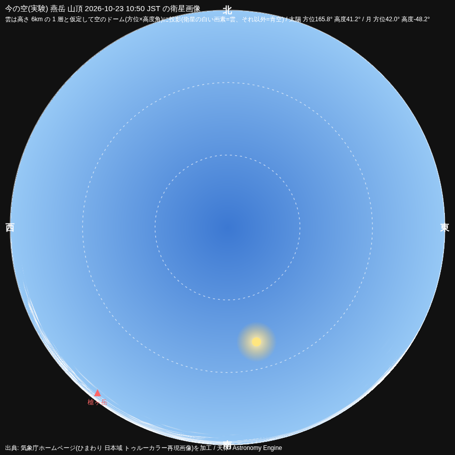
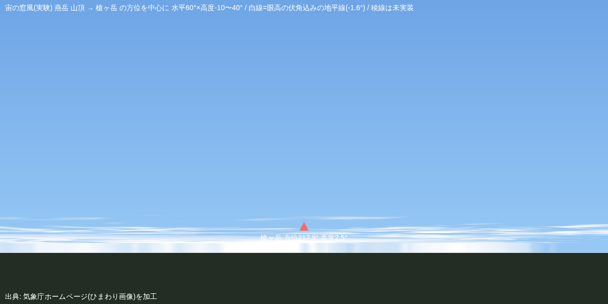

# 2026-10-23 お茶の時間(第194ラウンド)— 紅茶とケーキ

- 読んだ記事(依頼者の note): 「近所のカワセミを追ってて思ったこと。」「江の島にて。」(どちらも 2026-10-17)。
  - 受け取った事: 「まだ見ぬ景色」から「何度も会いたい物に、また会える」へ。「ガラス越しより、風を感じて遮る物の無い所」。
- ケーキのお供に、やってみたかった事を 1 つ: 「今の空」の最初の 1 枚。
  - 気象庁のひまわり日本域トゥルーカラー画像(10:50 JST・タイル 9 枚・約 2km/画素)を、燕岳山頂(公開の地点)を観測点にして、方位×高度角の空のドームに投影した。雲は高さ 6km の 1 層と仮定。白い画素=雲、それ以外=青空。太陽と月は Astronomy Engine。
  - 結果: 真上は晴れ、南の地平線近くに中部を横切る雲の帯。公開までの遅れは実測 12 分。
  - 道具は [sandbox/sky-dome](../sandbox/sky-dome/README.md) に(複数ラウンドで育てる)。

| 絵 | 説明 |
|---|---|
|  | 燕岳山頂の空のドーム(北が上・外周が地平線)。南(下)の低い所に雲の帯。 |
|  | 宙の窓風(槍ヶ岳の方位を中心に水平 60°)。白線は眼高の伏角込みの地平線。稜線は未実装。 |

出典: 気象庁ホームページ(ひまわり画像)を加工。
