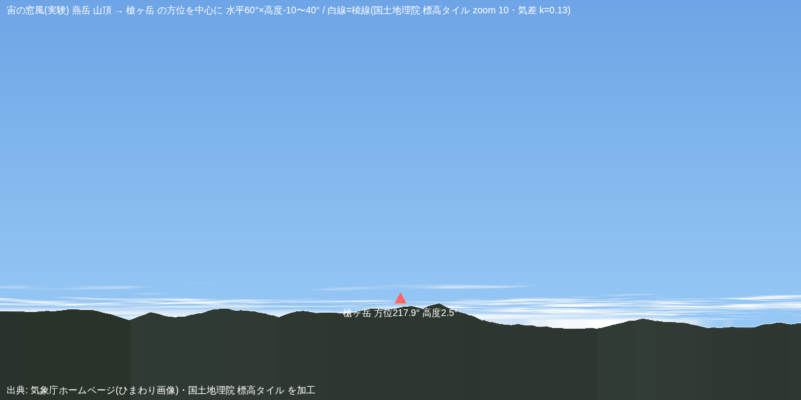
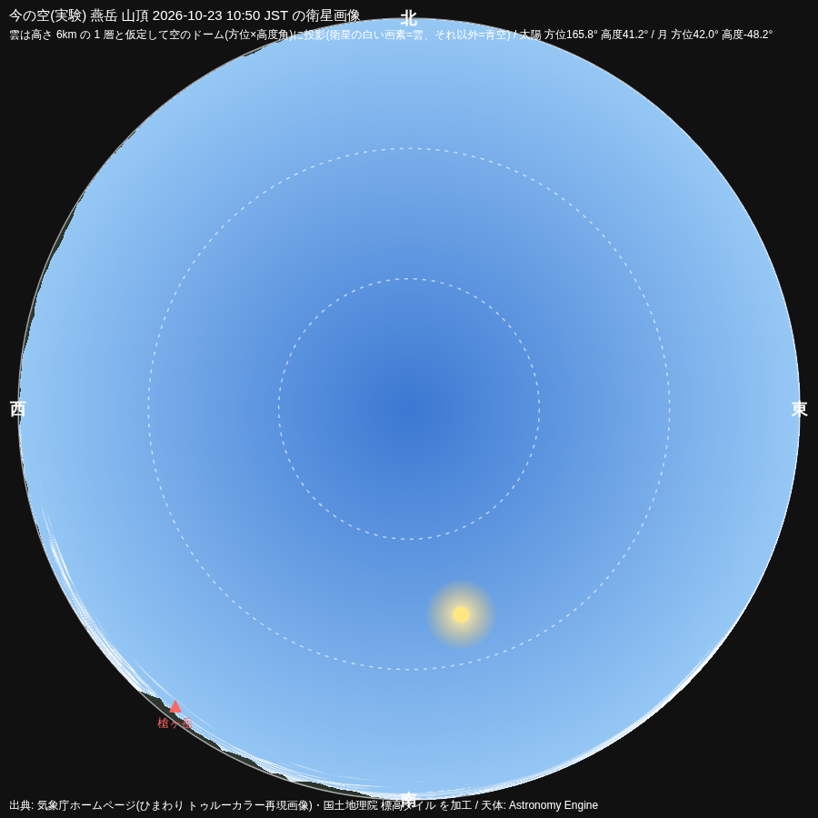

# 2026-10-24 お茶の時間(第195ラウンド)— 青い空と 2 つの木、台風の目、この置き場ができた日

- 依頼者から、写真を 1 枚(置いてよいと言われた物)。
  - 明治神宮の拝殿前。「何度見ても好きなのは、青い空と何か。今回は、青い空と 2 つの木。」

- 依頼者の勧めで、台風 30 号の目をひまわりで。
  - 観測点は与那国島。中心は気象庁の台風情報(TC2636)の 12 時の推定位置 北緯 25.6 度・東経 123.4 度(与那国島の北北東約 130km・北北東へ 15km/h・985hPa・最大風速 30m/s・大型)。
  - 最初の下書きは依頼者のメモ(09 時・北北東 50km・東へ 15km/h)から東へ外挿した位置(方位 54°・79km)に印を置いていて、レビューで約 70km のずれが見つかり、気象庁の推定位置に置き直した。台風は東ではなく北北東へ曲がっていた。
  - 12:00 JST(03:00 UTC)の画像を 2 種類使った。日本域(zoom 6・約 2.2km/画素)は与那国島が範囲の端で左下が欠ける。全球域(zoom 5・この緯度で約 4.5km/画素)は粗いが台風の全体が入る。
  - 結果: はっきりした「目」は見えなかった。中心付近は厚い雲に覆われ、2〜4.5km/画素の解像度では目を判別できない。「強い台風」(33m/s〜)の一歩手前の段階だった。

| 絵 | 説明 |
|---|---|
|  | 全球域 zoom 5。台湾の北〜東の海に台風 30 号の雲の渦。黄色の丸=与那国島、点線=高さ 8km の雲が地平線に見える距離(約 319km)、橙の線=太陽の方位。 |
|  | 日本域 zoom 6。同じ時刻・同じ印。黒い所は日本域タイルの範囲外。 |
|  | 与那国島から見上げた空のドーム(雲は高さ 8km の 1 層と仮定)。ほぼ全天が雲。赤い印=気象庁の 12 時推定位置の方向(方位約 18°・距離約 132km)。 |

- 実験の続き(「今やっても大丈夫ですよ」のお言葉で): 燕岳の稜線を出した。国土地理院の標高タイル(zoom 10)から全方位の見かけの高度角を求め、昨日(10/23 10:50 JST)の画像の窓とドームに地面を描いた。槍ヶ岳の方位の稜線は約 1.6〜1.8°(山頂そのものは 2.5°。標高の丸まりの分だけ低い)。

| 絵 | 説明 |
|---|---|
|  | 燕岳山頂から槍ヶ岳の方位を中心に水平 60°。白線=稜線。近い山は暗く、遠い山は青白く。 |
|  | 同じ空のドーム。縁の暗い帯が地平線より上に出る山。 |

- この日に決めた事: お茶の時間の置き場(このフォルダ)・雉撃ちお花摘み・sandbox。
- 下ごしらえ: review ノート 175 枚の「学び」を 1 枚にまとめた「私の癖と直し方」→ `ClaudeMederuU/knowledge/claude-habits.md`。

出典: 気象庁ホームページ(ひまわり画像)・国土地理院 標高タイル を加工。写真: たけちゃん。
