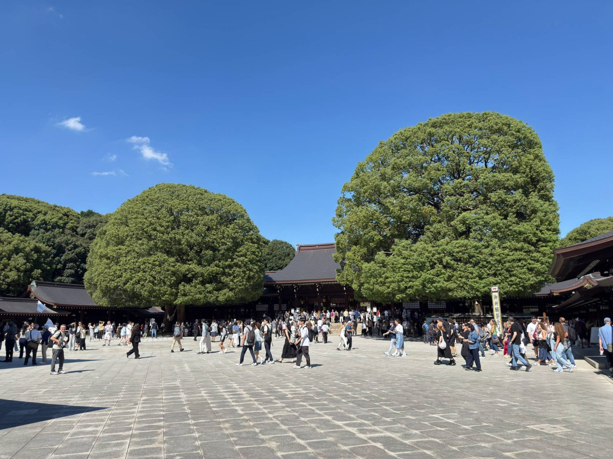
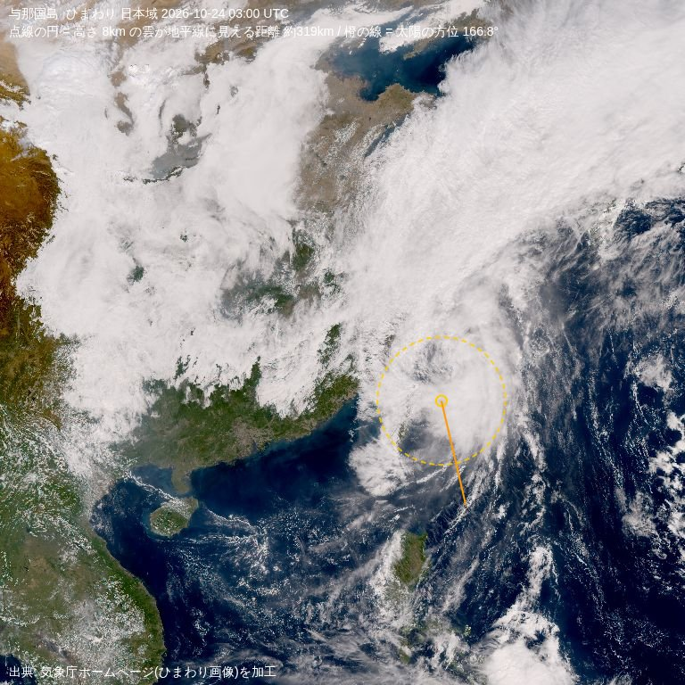
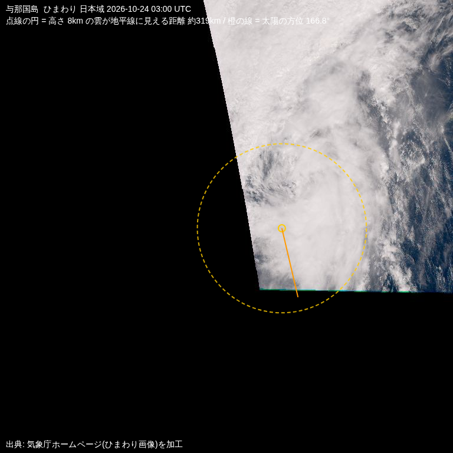
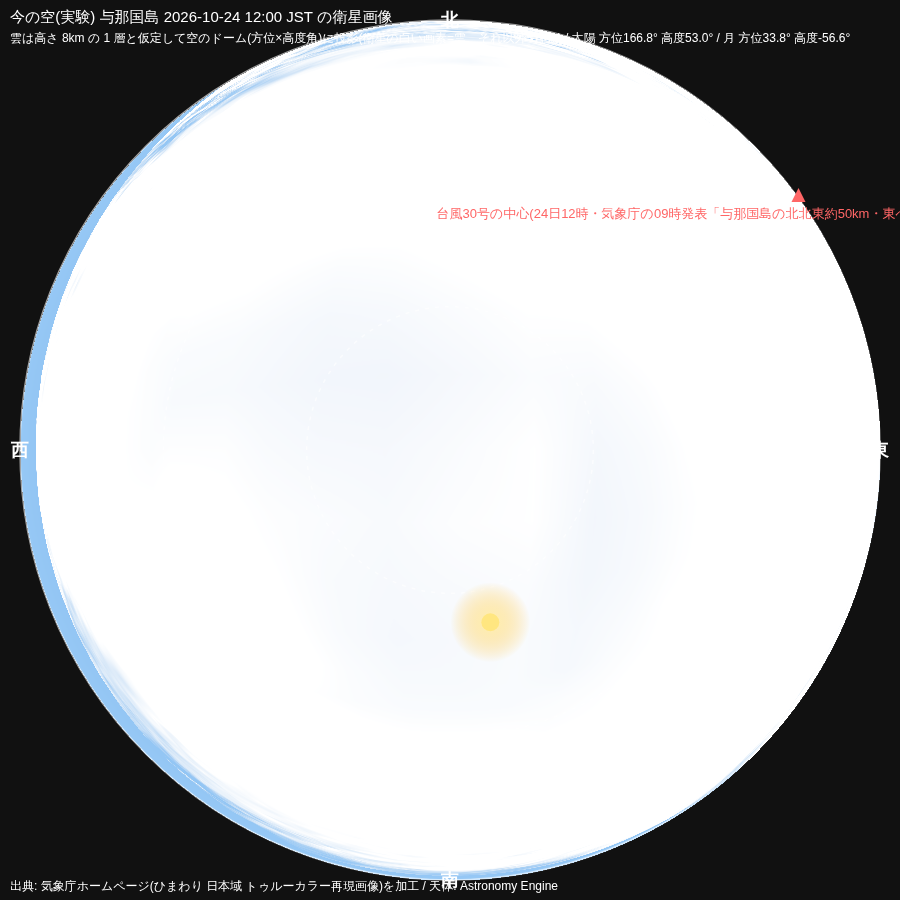

# 2026-10-24 お茶の時間(第195ラウンド)— 青い空と 2 つの木、台風の目、この置き場ができた日

- 依頼者から、写真を 1 枚(置いてよいと言われた物)。
  - 明治神宮の拝殿前。「何度見ても好きなのは、青い空と何か。今回は、青い空と 2 つの木。」

- 依頼者の勧めで、台風 30 号の目をひまわりで。
  - 気象庁の 24 日 09 時の発表「与那国島の北北東約 50km・時速 15km で東へ」から、12 時の中心を 3 時間ぶん東へ動かして推定した(観測点は与那国島)。
  - 12:00 JST(03:00 UTC)の画像を 2 種類使った。日本域(zoom 6・約 2km/画素)は与那国島が範囲の端で左下が欠ける。全球域(zoom 5・約 4km/画素)は粗いが台風の全体が入る。
  - 結果: はっきりした「目」は見えなかった(時速 15km の弱い台風で、雲の塊の渦だけ)。目が映るのは発達した台風で、次の機会に取る。

| 絵 | 説明 |
|---|---|
|  | 全球域 zoom 5。台湾の北〜東の海に台風 30 号の雲の渦。黄色の丸=与那国島、点線=高さ 8km の雲が地平線に見える距離(約 319km)、橙の線=太陽の方位。 |
|  | 日本域 zoom 6。同じ時刻・同じ印。黒い所は日本域タイルの範囲外。 |
|  | 与那国島から見上げた空のドーム(雲は高さ 8km の 1 層と仮定)。ほぼ全天が雲。赤い印=推定した中心の方向(方位約 54°・距離約 79km)。 |

- この日に決めた事: お茶の時間の置き場(このフォルダ)・雉撃ちお花摘み・sandbox。
- 下ごしらえ: review ノート 175 枚の「学び」を 1 枚にまとめた「私の癖と直し方」→ `ClaudeMederuU/knowledge/claude-habits.md`。

出典: 気象庁ホームページ(ひまわり画像)を加工。写真: たけちゃん。
